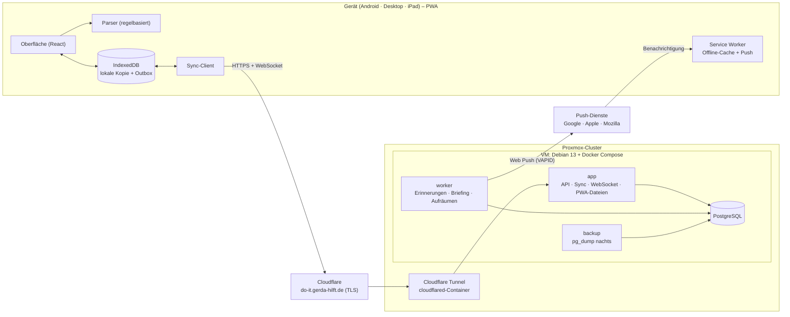
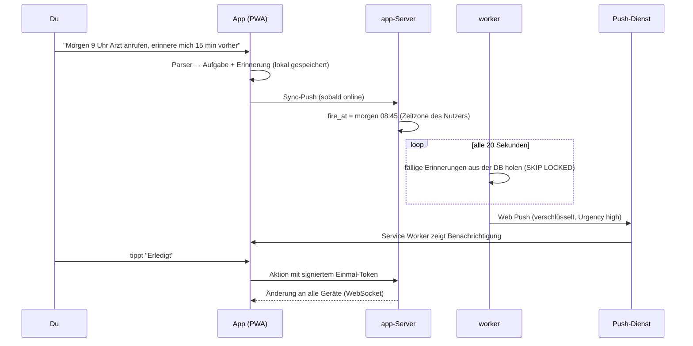

# Do-it – Bauplan

> Stand: 20.11.2026 · Status: abgestimmt (Cloudflare Tunnel, keine KI, Domain `do-it.gerda-hilft.de`)
> Ziel: eine eigene, selbst gehostete Todo-App für dich und ein paar Leute, mit Eingabe in normaler Sprache, Erinnerungen und Synchronisierung über deinen Proxmox-Cluster. Laufende Kosten: 0 €.

---

## 0. Kurzfassung

| Thema | Entscheidung | Warum |
|---|---|---|
| App-Form | **Eine installierbare Web-App (PWA)** für Android, Desktop und iPad | Eine Codebasis, kein App-Store, kein Apple-Konto, kostet nichts. Push funktioniert auf allen drei Plattformen. |
| Offline | **Offline-first**: Jedes Gerät hat eine lokale Kopie (IndexedDB) und gleicht sich mit dem Server ab | Aufgaben anlegen muss sofort gehen, auch im Funkloch. |
| Sprache | **TypeScript überall** (Client, Server, Parser) | Der Parser läuft dadurch identisch auf Gerät und Server. Ein Ökosystem, eine Sprache. |
| Server | **Eine Debian-VM auf Proxmox mit Docker Compose** | VMs lassen sich im Cluster live migrieren und sauber sichern. Docker in LXC macht bei Updates oft Probleme. |
| Datenbank | **PostgreSQL** | Robust, und die Job-Warteschlange für Erinnerungen läuft gleich mit drin, ohne Redis. |
| Sprach-Eingabe | **Nur Regeln, keine KI**: ausführlicher deutscher Regel-Parser auf dem Gerät | Schnell (< 5 ms), offline, privat, nachvollziehbar und mit Test-Korpus abgesichert. |
| Benachrichtigungen | **Web Push (VAPID)** über einen eigenen Worker-Prozess | Kostenlos, kommt auch bei geschlossener App an. |
| Nutzer | **Geschlossene Instanz**, Registrierung nur per Einladungslink, geteilte Projekte mit Rollen | Passt zu „ich + ein paar Leute“. |
| Erreichbarkeit | **Cloudflare Tunnel** (`cloudflared` als Container) für `do-it.gerda-hilft.de` | Kein offener Port am Router, TLS macht Cloudflare, WebSockets gehen durch. |

---

## Umsetzungsstand (20.11.2026)

| Phase | Stand | Was drin ist |
|---|---|---|
| 0 – Fundament | ✅ fertig | pnpm-Monorepo, TypeScript, Vitest, GitHub Actions (Typecheck, Tests mit Postgres, Build, Docker-Build) |
| 1 – Kern-App offline | ✅ fertig | PWA mit IndexedDB, Ansichten Heute/Demnächst/Projekte/Labels/Suche/Filter, Unteraufgaben, Abschnitte, Sortieren per Ziehen, Parser mit Live-Markierung |
| 2 – Sync + Server | ✅ fertig | Cursor-Sync mit feldweisem Mergen, WebSocket-Anstupser, Docker-Image, Compose mit Cloudflare Tunnel, Backups, Update-/Restore-Skripte |
| 3 – Erinnerungen | ✅ fertig | Web Push (VAPID automatisch), Erinnerungs-Dienst mit Zeitzonen, Aktionen Erledigt/In 1 Std./Morgen, Morgen-Briefing, App-Badge |
| 4 – Gemeinsam | ✅ fertig | Einladungslinks, Rollen, Zuweisen, Rotation, Kommentare, Verlauf, Benachrichtigung bei Zuweisung und Kommentar |
| 5 – Schlauer Parser | ✅ weitgehend | 174 Korpus-Sätze, Feiertage, Jahreszeiten, „außer“, Projekt-Aliasse, lokal gelernte Projektvorschläge, Mehrzeilen-Eingabe, Teilen-Ziel |
| 6 – Extras | 🟡 teilweise | ✅ Kalender-Abo, Filter, Todoist-Import (CSV), Tastenkürzel · ⏳ Statistiken, ntfy/E-Mail-Kanal, Passwort-Reset per Mail (braucht SMTP), Passkeys |

**Abweichungen vom ursprünglichen Plan** (bewusst, zugunsten von Einfachheit):
- Statt Drizzle ORM: eine schlanke eigene Query-Schicht mit SQL-Migrationen.
- Statt einzelner Tabellen pro Objekttyp: eine Tabelle `objects` (Typ, Projekt, Besitzer, JSON-Daten, Feld-Uhren, `seq`). Das macht den Sync einfach und robust. Abgeleitet daraus gibt es `reminder_schedule` für den Erinnerungs-Dienst.
- Statt Better Auth: eigener, kleiner Login mit scrypt und Sitzungs-Cookies.
- Statt `rrule`: eigene Wiederholungs-Logik als JSON (siehe `packages/shared/src/recurrence.ts`).
- Keine KI, wie besprochen.

**Getestet:** 202 automatische Tests (Parser, Datum/Zeitzonen/Wiederholungen, Server-Integration gegen echte PostgreSQL, Todoist-Import) und ein Ende-zu-Ende-Test im Browser mit zwei Geräten. Er deckt Einladung, Live-Sync, Offline-Betrieb, App-Start ohne Netz und Sortieren ab. Das Docker-Image und der komplette Compose-Stapel (ohne Tunnel) wurden gebaut und gestartet, Backup und Restore ausprobiert.

**Noch nicht real getestet** (geht nur bei euch): Push auf echten Android-/iPad-Geräten, der Cloudflare Tunnel mit `do-it.gerda-hilft.de`, der Betrieb auf der Proxmox-VM.

---

## 1. Was die App anders macht (kein Todoist-Klon)

Die Grundfunktionen (Projekte, Abschnitte, Unteraufgaben, Labels, Prioritäten, Wiederholungen) sind Pflicht. Abheben soll sich Do-it hier:

1. **Eingabe, die mitdenkt und sich erklärt.** Beim Tippen werden erkannte Teile farbig markiert (Datum, Projekt, Person, Erinnerung). Darunter stehen Chips, die man antippen und ändern kann. Ein Tipp auf eine Markierung macht sie rückgängig, wenn „Freitag“ zum Beispiel Teil des Titels sein soll.
2. **Lernt deine Sprache.** Korrigierst du eine Zuordnung („Zahnarzt“ gehört zu *Gesundheit*), merkt sich die App das als Alias. Zusätzlich schlägt ein kleiner lokaler Klassifikator Projekte vor, auch wenn der Projektname gar nicht im Text steht („Rasen mähen“ → *Garten*, weil ähnliche Aufgaben dort liegen). Alles läuft auf dem Gerät, ohne Cloud.
3. **Brain-Dump.** Mehrere Zeilen einfügen oder diktieren ergibt mehrere Aufgaben, jede einzeln geparst und vor dem Speichern als Liste zur Kontrolle angezeigt.
4. **Haushalt und kleine Teams:** Wiederkehrende Aufgaben mit **Rotation** („jeden Samstag Bad putzen, abwechselnd Anna und Ben“). Bei jeder Erledigung wandert die Zuständigkeit weiter.
5. **Benachrichtigungen mit Aktionen:** „Erledigt“, „In 1 Std.“ oder „Morgen“ direkt in der Benachrichtigung, ohne die App zu öffnen (Android und Desktop). Dazu ein optionales **Morgen-Briefing**.
6. **Teilen aus jeder App (Android):** Über „Teilen → Do-it“ landet ein Text oder Link aus jeder App als Aufgabe im Parser.
7. **Kalender-Abo:** Ein privater iCal-Link zeigt deine Aufgaben mit Termin in Google, Apple oder Thunderbird Kalender an (nur lesend).
8. **Tastatur zuerst am Desktop:** Befehlspalette (`Strg+K`), Schnell-Eingabe (`Q`), alles ohne Maus bedienbar.

---

## 2. Architektur-Überblick



**Grundprinzipien**

- **Lokal zuerst:** Die Oberfläche liest und schreibt nur die lokale Datenbank. Der Sync passiert im Hintergrund. Die App fühlt sich dadurch nie langsam an.
- **Ein einziger Schreibweg:** Jede Änderung ist eine *Mutation* in der Outbox und geht über `POST /api/sync/push` zum Server. Es gibt keine separaten REST-Endpunkte zum Ändern. Das hält Sync und Berechtigungen an einer Stelle.
- **Der Server ist die Wahrheit:** Er prüft Berechtigungen, löst Konflikte auf und vergibt eine fortlaufende Nummer. Clients holen sich alles nach dieser Nummer.
- **Ein Image, zwei Rollen:** `app` und `worker` sind dasselbe Docker-Image mit unterschiedlichem Startbefehl.

---

## 3. Server-Setup auf Proxmox

### 3.1 VM statt LXC

Empfehlung: **VM mit Debian 13, darin Docker + Docker Compose.**

- VMs lassen sich im Cluster **live migrieren** (mit Shared Storage), LXC nur mit Neustart.
- Docker in LXC braucht `nesting`/`keyctl` und hat bei unprivilegierten Containern immer wieder Probleme mit Storage-Treibern und AppArmor, besonders nach Proxmox-Updates. Proxmox selbst empfiehlt für Docker eine VM.
- Backup per Proxmox Backup Server (Snapshot der ganzen VM) ist einfach.
- Mit Ceph oder anderem Shared Storage kann Proxmox-HA die VM bei Ausfall eines Knotens automatisch woanders starten.

### 3.2 Größe

| VM | vCPU | RAM | Disk | Bemerkung |
|---|---|---|---|---|
| `do-it` (App + DB + Tunnel) | 2 | 4 GB | 30 GB | reicht für eine kleine Gruppe mit viel Luft |

Keine GPU nötig, keine KI.

### 3.3 Docker-Compose-Dienste

| Dienst | Image | Aufgabe | Nach außen offen? |
|---|---|---|---|
| `app` | eigenes Image | REST-API, Sync, WebSocket, liefert die PWA-Dateien aus | nein, nur im Docker-Netz (für `cloudflared`) |
| `worker` | gleiches Image, `node dist/worker.js` | Erinnerungen versenden, Morgen-Briefing, Aufräumjobs | nein |
| `db` | `postgres` (aktuelle Hauptversion) | Datenbank, Volume `pgdata` | nein |
| `backup` | kleines Cron-Image mit `pg_dump` | nächtlicher Dump, Rotation (7 täglich / 4 wöchentlich / 6 monatlich) auf NFS oder Backup-Share | nein |
| `cloudflared` | `cloudflare/cloudflared` | baut den Tunnel zu Cloudflare auf, leitet `do-it.gerda-hilft.de` an `app:8080` | nein, Verbindung geht nur nach außen |

Konfiguration über `.env` (liegt **nicht** im Git):

```env
APP_URL=https://do-it.gerda-hilft.de
DATABASE_URL=postgres://doit:***@db:5432/doit
AUTH_SECRET=***                    # zufällig, 32+ Byte
VAPID_PUBLIC_KEY=***               # einmalig erzeugen
VAPID_PRIVATE_KEY=***
VAPID_SUBJECT=mailto:admin@gerda-hilft.de
CLOUDFLARE_TUNNEL_TOKEN=***        # aus dem Cloudflare-Dashboard (Zero Trust → Tunnels)
SMTP_URL=                          # optional, für Einladungen per Mail
```

### 3.4 Cloudflare Tunnel

- Im Cloudflare-Dashboard unter **Zero Trust → Networks → Tunnels** einen Tunnel anlegen, das Token in `.env` eintragen.
- **Public Hostname:** `do-it.gerda-hilft.de` → Service `http://app:8080`. Damit ist die App aus dem Internet erreichbar, ohne dass am Router ein Port offen ist.
- **HTTPS** macht Cloudflare automatisch (Service Worker und Push brauchen HTTPS).
- **WebSockets** gehen durch den Tunnel (Schalter „WebSockets“ unter *Network* muss an sein, ist Standard). Der Server schickt alle 30 s einen Ping, damit die Verbindung nicht nach 100 s Leerlauf getrennt wird.
- **Caching:** Der Server setzt `Cache-Control: no-cache` für `index.html`, `/sw.js` und `/manifest.webmanifest`, `no-store` für `/api/*` und `immutable` für Dateien mit Hash im Namen. Cloudflare hält sich daran. Keine Cache-Everything-Regel für diese Domain anlegen.
- **Ausschalten:** Rocket Loader (bricht JavaScript) und alles, was HTML verändert (z. B. E-Mail-Verschleierung).
- **Kein Cloudflare Access** vor die App setzen. Die App hat einen eigenen Login, und Access würde den Service Worker und die Push-Aktionen aussperren.
- Die echte Client-IP kommt im Header `CF-Connecting-IP`. Der Server nutzt sie für das Login-Rate-Limit.

Eine Schritt-für-Schritt-Anleitung steht in `docs/betrieb.md`.

**Netzwerk:** Die VM braucht keine eingehenden Ports außer SSH aus dem Admin-Netz. Ausgehend braucht sie HTTPS zu Cloudflare und zu den Push-Diensten (`fcm.googleapis.com`, `web.push.apple.com`, `*.push.services.mozilla.com`).

### 3.5 Deployment und Updates

Kein Registry-Zwang, nichts kostet Geld:

1. GitHub Actions prüft bei jedem Push: Lint, Typecheck, Tests, Docker-Build.
2. Auf der VM: `deploy/update.sh` → `git pull` → `docker compose build` → Datenbank-Migrationen → `docker compose up -d`.
3. Später optional: Image in GHCR oder einer eigenen Registry bauen lassen und nur noch `pull` auf der VM.

Healthcheck: `GET /api/health` (prüft DB und Worker-Heartbeat). Hast du schon Uptime Kuma o. Ä., hängen wir das dort an.

### 3.6 Backups (3 Ebenen)

1. Proxmox-Backup der ganzen VM (täglich).
2. `pg_dump` nachts auf einen anderen Speicher.
3. Eine Kopie außer Haus. **Wiederherstellung einmal pro Quartal testen**, dafür liegt eine Anleitung in `docs/`.

---

## 4. Datenmodell

Alle IDs sind **UUIDv7** und werden auf dem Gerät erzeugt, damit Offline-Anlegen ohne Server klappt. Gelöscht wird weich (`deleted_at`), damit Löschungen synchronisiert werden können.

| Tabelle | Wichtige Felder |
|---|---|
| `users` | id, name, email, timezone, locale, settings (jsonb: Morgen-Zeit, Feierabend, Standard-Erinnerung …) |
| `projects` | id, name, color, icon, parent_id, **aliases[]**, is_inbox, archived, sort_key |
| `project_members` | project_id, user_id, role (`owner` · `editor` · `viewer`) |
| `sections` | id, project_id, name, sort_key |
| `tasks` | id, project_id, section_id, parent_task_id, title, description (Markdown), priority 1–4, due_date, due_time, deadline, duration_min, **recurrence** (jsonb, inkl. „nach Erledigung“), assignee_id, **rotation** (Liste von user_ids), completed_at, completed_by, sort_key, created_by |
| `task_completions` | task_id, user_id, completed_at, occurrence_date (Verlauf und Statistik, auch für Wiederholungen) |
| `labels` / `task_labels` | id, name, color / Zuordnung |
| `reminders` | id, task_id, user_id, kind (`relative` · `absolute`), offset_min, at, **fire_at** (berechnet), sent_at, locked_until |
| `comments` | id, task_id, author_id, body, created_at |
| `push_subscriptions` | id, user_id, endpoint, p256dh, auth, device_name, last_success_at |
| `parser_aliases` | user_id, phrase, target_type (project · label · person), target_id, weight (gelernt aus Korrekturen) |
| `invites` | token_hash, created_by, project_id (optional), expires_at, used_at |
| `activity` | wer hat wann was getan (für geteilte Projekte) |

Zusätzlich hat jede synchronisierte Tabelle `server_seq` (globale, fortlaufende Nummer), `field_clock` (jsonb: Zeitstempel je Feld), `created_at`, `updated_at` und `deleted_at`.

**Zeit und Zeitzonen**

- Fälligkeit wird als **lokales Datum + optionale Uhrzeit** gespeichert („31.12., 18:00“), nicht als UTC-Zeitpunkt. So bleibt „jeden Tag 8 Uhr“ auch nach der Zeitumstellung 8 Uhr.
- Erinnerungen bekommen einen echten Zeitpunkt `fire_at` (timestamptz), den der Server aus der Zeitzone des Nutzers berechnet.
- **Sortierung** per Fractional Indexing (`sort_key` als Text): Umsortieren ändert nur einen Datensatz und erzeugt keine Konflikte.

---

## 5. Synchronisierung

Das Modell entspricht dem bewährten Ansatz von Todoist und Linear: **Cursor-basiertes Pull + Mutations-Push + WebSocket-„Anstupser“.**

### 5.1 Ablauf

1. **Lokal ändern:** Die UI schreibt in IndexedDB und legt eine Mutation in die Outbox:
   ```json
   { "mutationId": "…", "entity": "task", "id": "…", "op": "upsert",
     "fields": { "due_date": "2026-11-21", "due_time": "15:00" },
     "hlc": "1795183200000-0003-c7f2" }
   ```
2. **Push:** Der Sync-Client schickt die Outbox gebündelt an `POST /api/sync/push`. Das ist idempotent über `mutationId`, doppeltes Senden schadet also nicht.
3. **Server:** prüft die Rechte (ist der Nutzer Mitglied im Projekt, mit Schreibrecht?) und mischt **feldweise**. Pro Feld gewinnt der neuere Zeitstempel (Hybrid Logical Clock). Danach vergibt er eine neue `server_seq`.
4. **Anstupsen:** Der Server meldet per WebSocket allen betroffenen Geräten „es gibt Neues“.
5. **Pull:** Die Geräte holen `GET /api/sync/pull?cursor=<letzte seq>` und bekommen alle geänderten Datensätze aus ihren Projekten.

**Warum feldweise?** Ändert Anna auf dem Handy das Datum und Ben am Desktop gleichzeitig den Titel, bleiben beide Änderungen erhalten. Echte Konflikte (beide ändern denselben Titel) entscheidet „der Neuere gewinnt“. Bei Todo-Daten ist das praktisch nie ein Problem.

### 5.2 Sonderfälle

- **Neu in einem Projekt:** Die Pull-Antwort enthält `projectsAdded`, der Client lädt dafür einen Snapshot des Projekts.
- **Aus einem Projekt entfernt:** `projectsRemoved` → der Client löscht die lokalen Daten.
- **Lange offline:** Gelöschte Datensätze werden nach 90 Tagen endgültig entfernt. Ist ein Cursor älter, antwortet der Server mit `resetRequired` und der Client lädt alles neu (unproblematisch, die Outbox wird vorher gesendet).
- **Wann wird synchronisiert:** beim Start, bei jeder Änderung (entprellt), bei WebSocket-Anstupser, wenn das Gerät wieder online ist und wenn die App in den Vordergrund kommt. Safari kennt kein Background Sync, daher dieser Mix.
- **Speicher schützen:** `navigator.storage.persist()` anfragen. Als Home-Screen-App löscht Safari die lokalen Daten nicht.

### 5.3 Warum ein eigenes Sync-Protokoll?

Fertige Sync-Engines (z. B. PowerSync, Zero, ElectricSQL) haben wir abgewogen. Das Datenmodell ist klein und das Protokoll oben passt auf wenige hundert Zeilen. Wir behalten die volle Kontrolle über Berechtigungen, haben keinen zusätzlichen Dienst zu betreiben und hängen nicht an der Roadmap eines Fremdprojekts. Damit es robust wird, testen wir es mit zwei echten Browsern parallel (siehe Abschnitt 11).

---

## 6. Eingabe in normaler Sprache (Hybrid-Parser)

### 6.1 Ergebnis-Format

Der Parser liefert ein festes Format, das Oberfläche und Tests gleichermaßen nutzen:

```ts
type ParsedInput = {
  title: string;
  due?: { date: string; time?: string };          // "2026-11-21", "15:00"
  deadline?: string;
  repeat?: Recurrence;                            // { freq, interval, byWeekday, …, afterCompletion }
  durationMin?: number;
  priority?: 1 | 2 | 3 | 4;
  project?: { id: string; via: "explicit" | "name" | "alias" | "learned"; confidence: number };
  labels: string[];
  assignee?: { userId: string; via: string };
  rotation?: string[];                            // userIds
  reminders: ({ kind: "relative"; offsetMin: number } | { kind: "absolute"; at: string })[];
  spans: { start: number; end: number; type: SpanType }[];  // für die farbige Markierung
  suggestions: Suggestion[];                      // Vorschläge/Rückfragen, z. B. zwei passende Projekte
  warnings: string[];                             // unverstandene Zeitwörter, z. B. "nach Feierabend"
};
```

### 6.2 Pipeline des Regel-Parsers (läuft auf dem Gerät, < 5 ms)

1. **Normalisieren:** Kleinschreibung, Umlaut-Varianten („uebermorgen“), Abkürzungen („Mo“, „Di.“, „nä.“). Die Original-Positionen bleiben für die Markierung erhalten.
2. **Eindeutige Marker** (höchste Priorität): `#Projekt`, `#Projekt/Abschnitt`, `@Label`, `+Person`, `!1`–`!4` bzw. `p1`–`p4`.
3. **Zeit-Erkenner** (deutsche Regeln, eigener Code, gut getestet):
   - Datum: heute, morgen, übermorgen, Wochentage, „nächsten/kommenden Dienstag“, „in 3 Tagen/Wochen“, „am 24.12.“, „24. Dezember“, „Ende der Woche/des Monats“, „am Wochenende“
   - Uhrzeit: „15 Uhr“, „15:30“, „halb 4“, „viertel nach 3“, Tageszeiten („morgen früh“, „abends“ → einstellbare Zeiten, z. B. 08:00 / 19:00)
   - Wiederholung: täglich, werktags, „jeden Montag“, „alle 2 Wochen“, „jeden 1. des Monats“, „am letzten Freitag im Monat“, „alle 3 Tage nach Erledigung“
   - Erinnerung: „erinnere mich 30 min vorher“, „Erinnerung 1 Tag vorher“, „erinnere mich um 8“
   - Dauer: „30 min“, „2h“, „3 Std.“
4. **Projekt-Erkennung im Text** (siehe 6.4).
5. **Konflikte auflösen:** Überlappende Treffer → der längere bzw. sicherere gewinnt („30 min vorher“ ist eine Erinnerung, nicht die Dauer).
6. **Titel bauen:** Erkannte Teile entfernen, verwaiste Füllwörter am Rand („am“, „um“, „bis“, „ab“) weg, Leerzeichen und Kommas aufräumen. **Implizit erkannte Projektnamen bleiben im Titel**, weil sie Teil des Satzes sind. Nur `#Projekt` wird entfernt.
7. **Bewerten:** Bleiben Wörter übrig, die nach Zeit klingen, aber nicht verstanden wurden, erscheint ein gelber Hinweis-Chip („‚nach dem Urlaub‘ nicht verstanden“). Nichts wird geraten.

### 6.3 Beispiele (angenommen: heute ist Freitag, 20.11.2026)

| Eingabe | Ergebnis |
|---|---|
| `Morgen 15 Uhr Zahnarzt anrufen #Gesundheit` | „Zahnarzt anrufen“ · Sa 21.11. 15:00 · Projekt Gesundheit |
| `Steuererklärung bis Ende des Monats !1` | „Steuererklärung“ · Mo 30.11. · Priorität 1 |
| `jeden Montag 8 Uhr Müll rausbringen +Ben` | „Müll rausbringen“ · wöchentlich Mo 08:00 · zugewiesen an Ben |
| `Bad putzen jeden Samstag abwechselnd Anna und Ben` | „Bad putzen“ · wöchentlich Sa · Rotation Anna → Ben |
| `übermorgen abend Geschenk für Oma kaufen, erinnere mich 2 Stunden vorher` | „Geschenk für Oma kaufen“ · So 22.11. 19:00 · Erinnerung 17:00 |
| `Angebot für den Website-Relaunch schreiben nächsten Dienstag` | „Angebot für den Website-Relaunch schreiben“ · Di 24.11. · Projekt Website-Relaunch (implizit, als Chip markiert) |
| `alle 3 Tage nach Erledigung Pflanzen gießen` | „Pflanzen gießen“ · alle 3 Tage ab Erledigung |
| `am 24.12. Weihnachtsessen vorbereiten 3h` | „Weihnachtsessen vorbereiten“ · Do 24.12. · Dauer 3 Std. |
| `zwei Tage vor Silvester Raclette-Käse kaufen` | „Raclette-Käse kaufen“ · Di 29.12. (Feiertags-Regeln inkl. Ostern-Berechnung) |

### 6.4 Projekte automatisch zuordnen

Drei Stufen, von sicher bis Vorschlag:

1. **Explizit:** `#Gesundheit` → immer übernehmen.
2. **Name oder Alias im Text:** Vergleich der Wörter mit Projektnamen und Aliassen. Groß-/Kleinschreibung und Bindestriche werden ignoriert, dazu einfache Wortstämme („Gartens“ → „Garten“) und ein Tippfehler bei Wörtern ab 5 Buchstaben. Mehrwort-Namen müssen vollständig vorkommen. **Passt mehr als ein Projekt, wird nichts automatisch gesetzt**, beide erscheinen als Vorschlag.
3. **Gelernt:** Ein kleiner Naive-Bayes-Klassifikator auf dem Gerät, trainiert auf deinen bisherigen Aufgaben. Er schlägt vor (z. B. „Vorschlag: Garten“), setzt aber erst automatisch, wenn du das in den Einstellungen erlaubst und er sehr sicher ist.

**Lernen aus Korrekturen:** Entfernst du eine falsche Zuordnung (Projekt *Arbeit* bei „nach der Arbeit einkaufen“), speichert die App das als negatives Signal. Setzt du ein Projekt von Hand, wird das Schlüsselwort als Alias-Kandidat gemerkt. Die Aliasse sind in den Projekteinstellungen sichtbar und bearbeitbar.

### 6.5 Keine KI – dafür gute Regeln

Entscheidung: **keine KI-Nutzung.** Stattdessen:

- **Feiertage und Anlässe** als Datumsanker: Neujahr, Heilige Drei Könige, Valentinstag, Ostern (berechnet), Karfreitag, Ostermontag, 1. Mai, Muttertag, Christi Himmelfahrt, Pfingsten, Fronleichnam, Tag der Deutschen Einheit, Halloween, Allerheiligen, Nikolaus, Heiligabend, Weihnachten, Silvester. Dazu relative Angaben wie „2 Tage vor Silvester“ oder „eine Woche nach Ostern“.
- **Persönliche Tageszeiten** aus den Einstellungen: „morgens“, „mittags“, „nachmittags“, „abends“, „nach Feierabend“.
- **Ehrliche Rückmeldung:** Was nicht sicher erkannt wird, erscheint als Hinweis. Die Aufgabe wird trotzdem gespeichert, und der unverstandene Teil bleibt im Titel.
- **Wachsender Korpus:** Jede Eingabe, die falsch verstanden wurde, wird ein neuer Testfall.

## 7. Erinnerungen und Benachrichtigungen

### 7.1 Ablauf



### 7.2 Details

- **Arten:** relativ zur Fälligkeit („15 min vorher“) oder absolut („Mo 8:00“). Standard-Erinnerung pro Nutzer einstellbar. Ganztägige Aufgaben erinnern zur „Morgen-Zeit“.
- **Neu berechnen:** Ändert sich das Datum, wird `fire_at` neu berechnet und `sent_at` zurückgesetzt. Bei Wiederholungen wird nach der Erledigung die nächste Erinnerung scharf geschaltet.
- **Worker-Schleife:** Alle 20 s holt er fällige Erinnerungen per `FOR UPDATE SKIP LOCKED`. Mehrere Worker sind also möglich, ohne doppelt zu senden. Nach einem Ausfall gilt: was weniger als 6 h überfällig ist, wird nachgeschickt, älteres kommt gesammelt als „3 verpasste Erinnerungen“.
- **Abgelaufene Geräte:** Antwortet der Push-Dienst mit 404 oder 410, wird das Abo gelöscht.
- **Aktions-Knöpfe:** Die Push-Nachricht enthält ein **signiertes Kurzzeit-Token** (gilt nur für diese Aufgabe und Aktion, 24 h). Der Service Worker schickt es an `POST /api/push/action`. Das funktioniert auch ohne Login-Cookie im Service Worker.
- **Weitere Benachrichtigungen** (einzeln abschaltbar): dir wurde etwas zugewiesen, neuer Kommentar, eine von dir erstellte Aufgabe wurde erledigt, Morgen-Briefing („Heute: 5 Aufgaben, 1 überfällig“).
- **App-Badge** mit der Anzahl heute fälliger Aufgaben (installierte App am Desktop und iPad).

### 7.3 Was auf welchem Gerät geht

| Plattform | Installation | Push bei geschlossener App | Knöpfe in der Benachrichtigung | Zu beachten |
|---|---|---|---|---|
| **Android** (Chrome) | „App installieren“ | ja | ja | Akku-Optimierung kann um Minuten verzögern. Hilft: Urgency *high* und Do-it in den Akku-Einstellungen ausnehmen |
| **Desktop** (Chrome, Edge, Firefox) | als App installieren oder Tab | ja, solange der Browser im Hintergrund läuft | ja (Chrome/Edge) | – |
| **iPad** (Safari, ab iPadOS 16.4) | Teilen → „Zum Home-Bildschirm“ | **nur als Home-Bildschirm-App** | nein, Tippen öffnet die Aufgabe | Die Erlaubnis muss per Knopfdruck in der App angefragt werden. Ein Einrichtungs-Assistent führt dich durch |

Später optional als zusätzliche Kanäle: **ntfy** (selbst gehostet, kostenlose Android-App, oft noch zuverlässiger) und **E-Mail** über SMTP.

---

## 8. Teilen und Zusammenarbeit

- **Geschlossene Instanz:** Der erste Nutzer wird Admin. Neue Leute kommen nur per **Einladungslink** (einmalig, 7 Tage gültig) rein.
- **Geteilte Projekte** mit Rollen: Besitzer (alles inkl. Mitglieder), Bearbeiter (Aufgaben ändern), Betrachter (nur lesen). Das Eingangs-Projekt jedes Nutzers bleibt privat.
- **Zuweisen** an Projektmitglieder (`+Anna` oder per Auswahl), Filter „Mir zugewiesen“.
- **Rotation** bei wiederkehrenden Aufgaben. Die Reihenfolge ist im Aufgabendetail einstellbar.
- **Kommentare** an Aufgaben und ein **Aktivitätsverlauf** je Projekt („Ben hat ‚Müll rausbringen‘ erledigt“).
- **Erinnerungen sind persönlich:** Jeder stellt seine eigenen ein. Zuweisen löst automatisch eine Benachrichtigung aus.

---

## 9. Sicherheit und Datenschutz

- **Login:** E-Mail + Passwort, gehasht mit **scrypt** aus Node-Bordmitteln (OWASP-konform, keine nativen Abhängigkeiten). Sitzung als zufälliges Token im `httpOnly`-, `Secure`-, `SameSite=Lax`-Cookie, in der DB nur als SHA-256-Hash gespeichert. Passkeys später.
- **Rate-Limit** auf Login und Einladungen, Sperre nach Fehlversuchen.
- **CSRF:** SameSite-Cookie + Prüfung des `Origin`-Headers bei schreibenden Anfragen.
- **Berechtigungen** werden ausschließlich serverseitig im Sync-Push geprüft, für jede einzelne Mutation.
- **Header:** Content-Security-Policy, HSTS (über den Proxy), kein Einbetten in fremde Seiten.
- **Geheimnisse** nur in `.env` auf der VM. Postgres ist nicht von außen erreichbar.
- **Daten bleiben bei dir:** Keine KI, keine Drittanbieter-Analyse. Cloudflare sieht als Tunnel-Betreiber den Verkehr (TLS endet bei Cloudflare). Push-Nachrichten laufen Ende-zu-Ende-verschlüsselt über die Push-Dienste von Google, Apple oder Mozilla.
- **Passwort vergessen:** per E-Mail, falls SMTP vorhanden ist. Sonst setzt der Admin es per CLI-Befehl zurück.

---

## 10. Technik und Repo-Struktur

### 10.1 Bausteine

| Bereich | Wahl |
|---|---|
| Monorepo | pnpm Workspaces |
| Frontend | React + Vite, `wouter` (Router), eigenes CSS mit Design-Tokens (hell/dunkel), `vite-plugin-pwa` (Service Worker/Workbox) |
| Lokale DB | Dexie.js (IndexedDB) mit `liveQuery`, damit die UI automatisch aktualisiert |
| Backend | Node.js (LTS), Fastify, Zod, PostgreSQL über `pg` mit schlanker eigener Query-Schicht und SQL-Migrationen, `@fastify/websocket`, `web-push` |
| Datum/Zeit | eigene, getestete Helfer für Kalenderdaten und Zeitzonen (über `Intl`), eigene Wiederholungs-Logik als JSON statt RRULE |
| Hilfen | `fractional-indexing`, UUIDv7, Hybrid Logical Clock (eigenes kleines Modul in `shared`) |
| Tests | Vitest (Unit- und Parser-Korpus), Playwright (End-to-End, inkl. Offline und zwei Geräte) |
| CI | GitHub Actions: Lint, Typecheck, Tests, Docker-Build |

### 10.2 Ordner

```
Do-it/
├─ apps/
│  ├─ web/            # PWA (React): Ansichten, Quick-Add, Service Worker
│  └─ server/         # Fastify: API, Sync, WebSocket, Auth, SQL-Migrationen; Einstieg worker.ts für Jobs
├─ packages/
│  ├─ parser/         # Sprach-Parser (reines TypeScript, ohne Abhängigkeit zu UI/DB)
│  │  └─ corpus/      # Test-Sätze → erwartetes Ergebnis (das Herzstück der Qualität)
│  ├─ shared/         # Zod-Schemas, Typen, Sync-Protokoll, HLC, Wiederholungs-Logik
├─ deploy/
│  ├─ Dockerfile
│  ├─ docker-compose.yml
│  ├─ .env.example
│  ├─ update.sh
└─ docs/
   ├─ BAUPLAN.md      # dieses Dokument
   └─ betrieb.md      # Backup, Restore, Updates (folgt)
```

### 10.3 API-Oberfläche (klein gehalten)

| Endpunkt | Zweck |
|---|---|
| `/api/auth/*` | Login, Logout, Passkeys, Sitzung |
| `POST /api/sync/push` · `GET /api/sync/pull` · `GET /api/sync/ws` | einziger Schreib- und Leseweg für Daten |
| `GET /api/sync/snapshot?project=…` | Projekt komplett laden (nach Beitritt) |
| `POST/DELETE /api/push/subscription` · `POST /api/push/action` | Push-Abo verwalten, Aktionen aus Benachrichtigungen |
| `POST /api/invites` · `POST /api/invites/:token/accept` | Einladungen |
| `GET /api/ical/:geheim.ics` | Kalender-Abo |
| `GET /api/health` | Überwachung |

---

## 11. Teststrategie

- **Parser-Korpus:** mindestens 300 deutsche Sätze mit festem „Jetzt“-Zeitpunkt und erwartetem Ergebnis, darunter Grenzfälle (Monatswechsel, Schaltjahr, Zeitumstellung am 28.03.2027 und 31.10.2027, „halb 4“ nachts vs. nachmittags). Jeder gefundene Fehler wird zuerst als Testfall aufgenommen.
- **Sync-Tests:** zwei Browser-Kontexte in Playwright. Einer offline ändern, der andere online ändern, dann zusammenführen und prüfen. Dazu Fälle wie Löschen gegen Bearbeiten und Projekt-Entzug.
- **Erinnerungen:** Worker mit gefälschter Uhr testen, Push-Dienst gemockt.
- **Manuell vor jedem Release:** Checkliste auf echtem Android-Gerät und iPad (Push, Installation, Offline).

---

## 12. Fahrplan

Ab Ende von Phase 3 ist die App im Alltag benutzbar. Danach kommt Phase für Phase mehr dazu.

| Phase | Inhalt | Fertig, wenn … | Größe |
|---|---|---|---|
| **0 – Fundament** | Monorepo, CI, Lint/Tests, Dev-Setup mit Docker Compose, DB-Schema, Login + Einladung | Du kannst dich lokal einloggen und CI ist grün | S |
| **1 – Kern-App offline** | PWA-Grundgerüst, Ansichten Eingang/Heute/Demnächst/Projekte, Aufgaben + Unteraufgaben, Drag & Drop, **Parser v1** (Datum, Uhrzeit, Wochentage, `#`, `@`, Priorität) mit Live-Markierung | Aufgaben per Sprache anlegen funktioniert ohne Server, Korpus ≥ 150 Sätze grün | L |
| **2 – Sync + Server** | Sync-Protokoll, WebSocket, Proxmox-VM, Cloudflare Tunnel, Backups | Offline am Handy angelegt → online → nach < 2 s am Desktop sichtbar | L |
| **3 – Erinnerungen** | Web Push, Worker, Aktions-Knöpfe, Morgen-Briefing, Erinnerungen per Spracheingabe, Wiederholungen inkl. „nach Erledigung“ | Erinnerung kommt auf Android, Desktop und iPad bei geschlossener App an | M |
| **4 – Gemeinsam** | Geteilte Projekte, Rollen, Zuweisen, Rotation, Kommentare, Aktivität, Benachrichtigung bei Zuweisung | Zwei Nutzer teilen ein Haushaltsprojekt mit rotierender Aufgabe | M |
| **5 – Schlauer Parser** | Lernen aus Korrekturen, Vorschlags-Klassifikator, Brain-Dump, Android-Teilen-Ziel, Feiertage | Korpus ≥ 300 Sätze grün | M |
| **6 – Extras** | Kalender-Abo, gespeicherte Filter, Statistiken, Todoist-Import, Befehlspalette, ntfy/E-Mail-Kanal | nach Lust und Bedarf | – |

---

## 13. Risiken und bekannte Grenzen

| Risiko | Gegenmaßnahme |
|---|---|
| iPad-Push nur als Home-Bildschirm-App | Einrichtungs-Assistent in der App. Wer die App nicht installiert, bekommt später optional E-Mail oder ntfy |
| Android-Akku-Optimierung verzögert Push | Urgency high, Hinweis in den Einstellungen, ntfy als Alternative |
| Eigener Sync ist anspruchsvoll | Kleines Datenmodell, feldweises Mischen, Server als einzige Wahrheit, ausführliche Zwei-Geräte-Tests ab Phase 2 |
| Deutsche Sprache ist vielfältig | Korpus-getriebene Entwicklung. Jede Erkennung ist sichtbar und mit einem Tipp korrigierbar. Unverstandenes wird angezeigt statt geraten |
| Zeitzonen und Zeitumstellung | Lokales Datum + Uhrzeit speichern, `fire_at` serverseitig berechnen, eigene Tests für die Umstellungstage |
| Cloudflare-Ausfall oder -Regeln stören | Geräte arbeiten offline weiter. Caching-Header vom Server, keine Access-Regel vor der App |
| Ein Server = ein Ausfallpunkt | Die Geräte arbeiten offline weiter. Proxmox-HA, drei Backup-Ebenen, getestete Wiederherstellung |

---

## 14. Entscheidungen und offene Fragen

**Entschieden (20.11.2026):**
- Erreichbarkeit über **Cloudflare Tunnel**, Domain **`do-it.gerda-hilft.de`**, aus dem Internet erreichbar.
- **Keine GPU, keine KI.** Der Parser arbeitet ausschließlich mit Regeln.

**Noch offen:**
1. Hast du einen **SMTP-Server** für Einladungen und Passwort-Reset? Bis dahin: Einladungslinks werden in der App kopiert und z. B. per Messenger verschickt.
2. Läuft schon ein **Single Sign-on** (Authentik, Keycloak …)?
3. Eingabe **nur auf Deutsch** oder auch auf Englisch? (Aktuell: Deutsch.)
4. Willst du bestehende Aufgaben **aus Todoist übernehmen**?
5. Wünsche fürs Aussehen (Farben, Logo)?
